<p align="center">
  
</p>

<h1 align="center">Tagio</h1>

<p align="center"><strong>Point at a price tag. See it in your money.</strong></p>

<p align="center">
  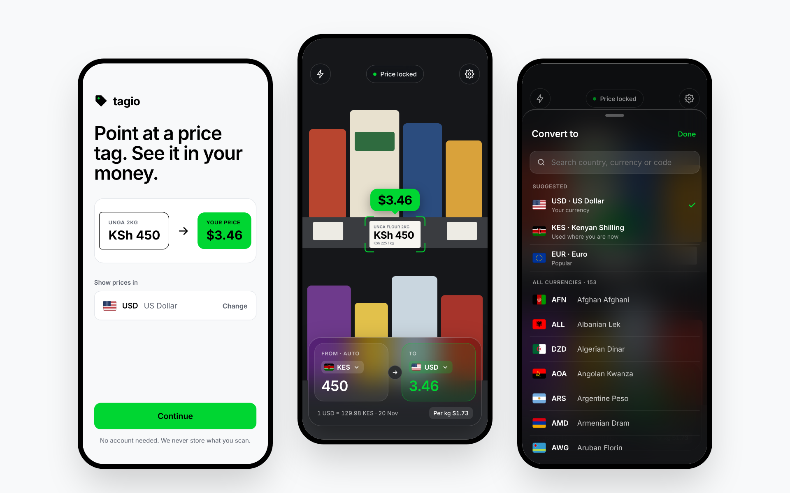
</p>

Tagio is an iOS and Android app for people shopping in a currency they don't think in yet, such as someone who has just moved abroad or is travelling. Open the app, point the camera at a price tag, and the price appears in your own currency. You don't tap anything, you don't need an account, and nothing you scan is stored.

---

## Contents

- [Screens](#screens)
- [Features](#features)
- [How it works](#how-it-works)
- [Privacy](#privacy)
- [Plans and friend keys](#plans-and-friend-keys)
- [Repository layout](#repository-layout)
- [Tech stack](#tech-stack)
- [Getting started](#getting-started)
- [Configuration](#configuration)
- [Server API](#server-api)
- [Emails](#emails)
- [Testing](#testing)
- [Design system](#design-system)
- [Before launch](#before-launch)
- [Known limitations](#known-limitations)

---

## Screens

These images come from the design mockups.

<table>
  <tr>
    <td align="center" width="25%">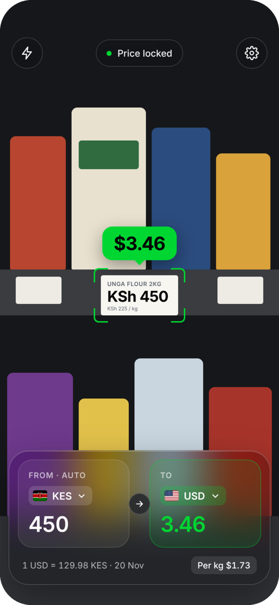<br /><sub><b>Scan</b>: the price locks and converts, with the glass bar below</sub></td>
    <td align="center" width="25%">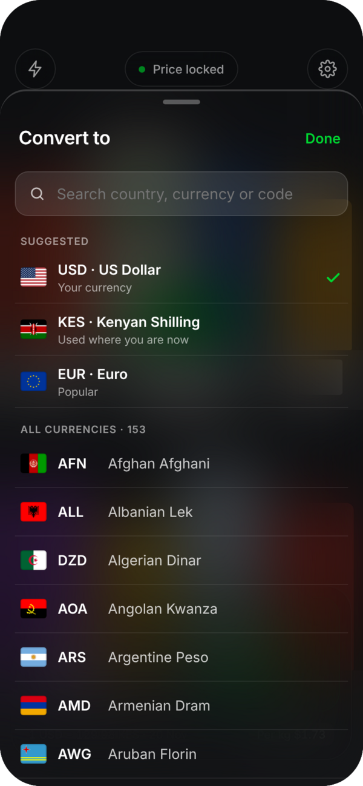<br /><sub><b>Convert to</b>: tap either side for all 153 currencies</sub></td>
    <td align="center" width="25%">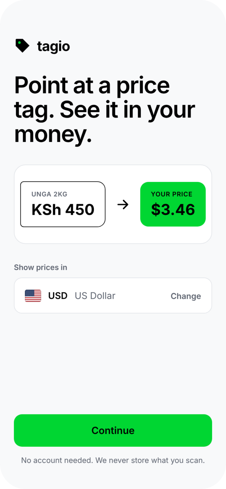<br /><sub><b>Welcome</b>: pick the currency to show</sub></td>
    <td align="center" width="25%">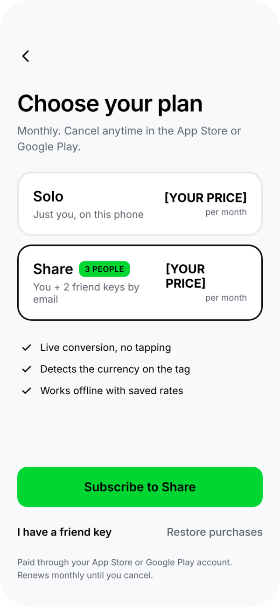<br /><sub><b>Plans</b>: Solo or Share, through the stores</sub></td>
  </tr>
  <tr>
    <td align="center">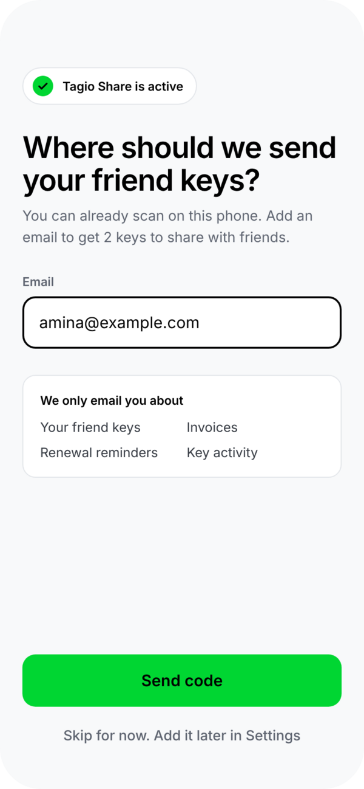<br /><sub><b>Email</b>: where friend keys, receipts and reminders go</sub></td>
    <td align="center">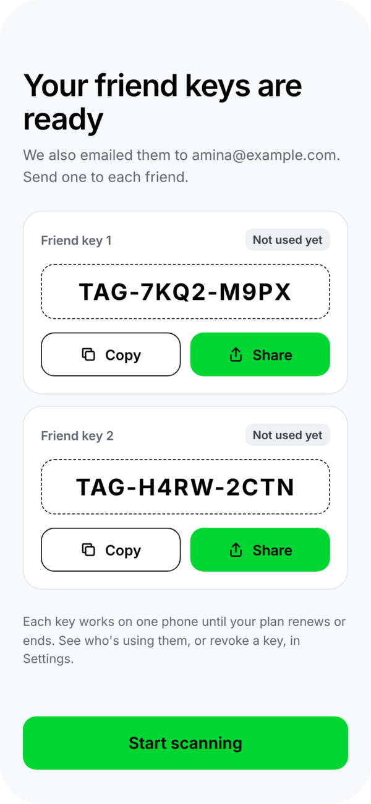<br /><sub><b>Friend keys</b>: 2 keys to copy or share</sub></td>
    <td align="center">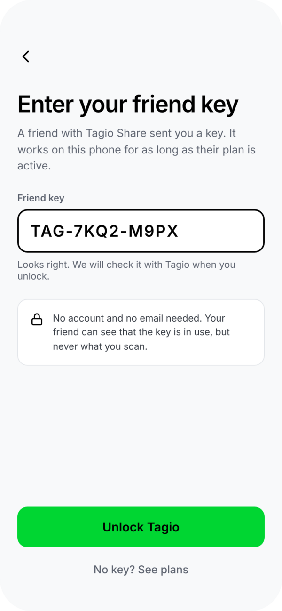<br /><sub><b>Redeem</b>: a friend unlocks with a key</sub></td>
    <td align="center">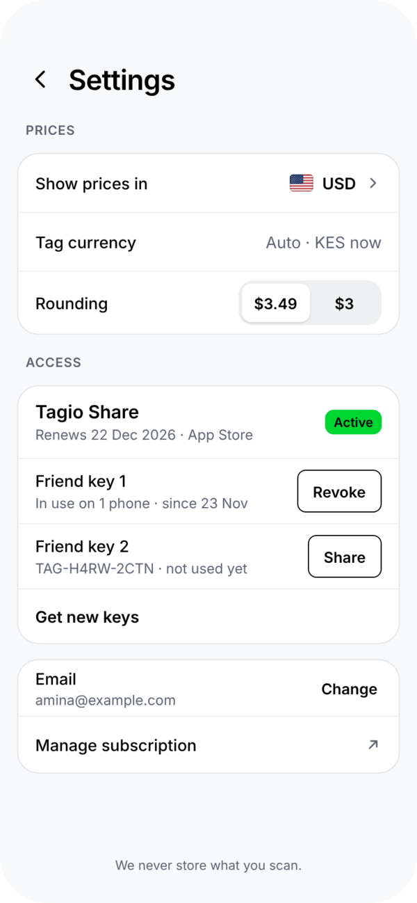<br /><sub><b>Settings</b>: currencies, rounding, plan and friend slots</sub></td>
  </tr>
  <tr>
    <td align="center">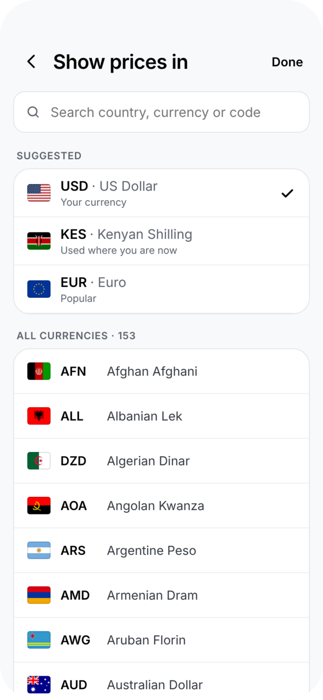<br /><sub><b>Currency picker</b>: suggested, then A–Z with search</sub></td>
    <td align="center">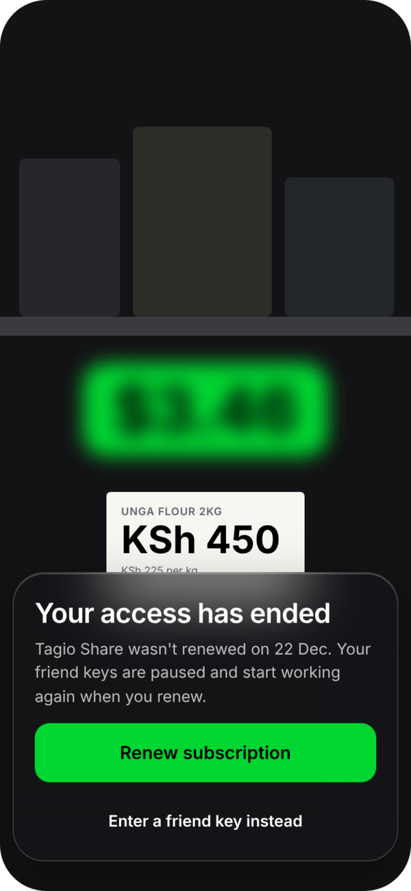<br /><sub><b>Access ended</b>: renew or use a friend key</sub></td>
    <td></td>
    <td></td>
  </tr>
</table>

## Features

| | |
|---|---|
| **Live conversion** | The camera opens straight away. A converted price appears as soon as a tag is inside the scan guide. |
| **Reads real tags** | Handles `1,299.00`, `1.299,00`, `1 299,50`, `450/-`, `KSh 450`, `€3,49`, split cents and more. It skips weights, dates, percentages and barcodes. |
| **Detects the tag's currency** | Reads ISO codes and symbols. Settles shared symbols such as `$`, `kr` and `Sh` by the phone's region. You can always pick the currency by hand. |
| **Steady numbers** | A price locks after two matching reads and stays until a different tag comes into view, so the number doesn't flicker. |
| **153 currencies** | Every active ISO 4217 currency with its flag, searchable by country, currency name or code. |
| **Works offline** | Uses the last downloaded rates and says how old they are. A bundled snapshot covers the very first launch. |
| **Per-unit prices** | Shows a second price printed on the tag, such as per kg or per litre, as a small chip. |
| **Glass UI** | A frosted conversion bar over the camera. Tap From or To to change either currency. |
| **Accessible** | System font (San Francisco / Roboto), screen reader labels, tap targets of 44 pt or more, and it respects Reduce Motion. |

## How it works

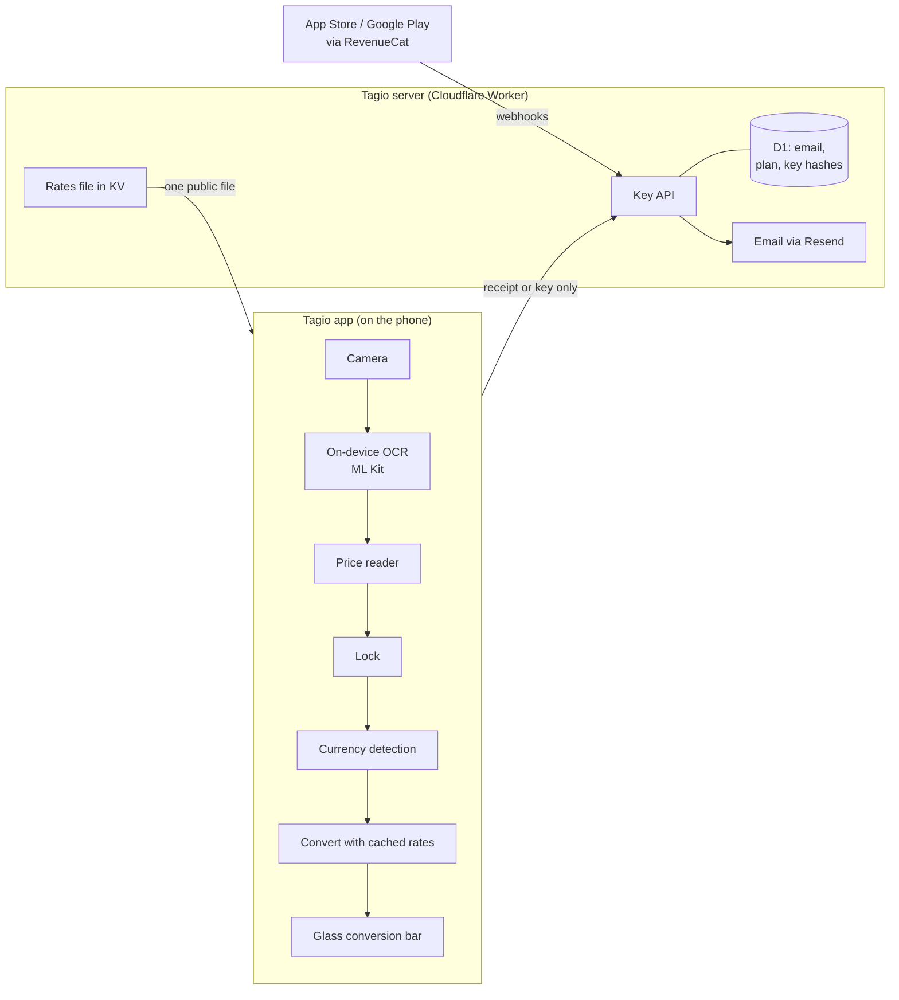

1. **Camera and OCR.** VisionCamera streams frames to Google ML Kit text recognition on the device. Only a band in the middle of the frame is read, which is the area inside the on-screen guide.
2. **Price reader** (`app/src/core/price.ts`) finds price-like numbers in each line and scores them. Bigger text, a currency marker and cents score higher. Unit prices and "was" prices score lower.
3. **Lock** (`app/src/core/locker.ts`) samples results every 250 ms. A price locks after two matching samples and is released after about 1.5 s with no price.
4. **Currency detection** (`app/src/core/detect.ts`) checks, in order: an ISO code next to the number, a symbol (shared ones are settled by the phone's region or the last confirmed currency), then the region alone.
5. **Conversion** (`app/src/core/money.ts`) goes through USD-based rates and is formatted per currency, so JPY shows no decimals and KWD shows three.

## Privacy

Tagio never stores what you scan. The server keeps only what billing and friend keys need.

| Data | Where | Kept for |
|---|---|---|
| Camera frames, OCR text, prices | Phone memory only | Dropped after each frame; never written to disk |
| Settings (currencies, rounding) | Phone | Until the app is deleted |
| Exchange rates | Phone cache | Replaced on each refresh |
| Subscriber email | Server (D1) | While subscribed |
| Store user id (anonymous RevenueCat id) | Server | While subscribed |
| Friend keys | Server: SHA-256 hash for lookup, AES-GCM encrypted copy for the owner | Until replaced |
| Install id per friend slot (random, not a hardware id) | Server | Until the slot is replaced |

The app has no analytics, no ad SDKs and no location permission. The phone's region comes from its language and region settings. Rates are one public file holding every currency, so the server never learns which currencies you use.

## Plans and friend keys

| Plan | Who can use it |
|---|---|
| **Solo** | The subscriber, on their own phone |
| **Share** | The subscriber plus **2 friends**, each with a friend key |

- Plans are monthly subscriptions sold through the **App Store and Google Play**, managed with RevenueCat. The subscriber never needs a key; access comes straight from the store, and **Restore purchases** works on a new phone.
- After buying Share, the subscriber confirms an email with a 6-digit code. Tagio then emails **2 friend keys** in the form `TAG-7KQ2-M9PX`.
- A friend taps **I have a friend key** and enters it. No account or email is needed.
- Each key works on **one phone**. It can move to a new phone once every 30 days.
- The subscriber can see both slots in **Settings › Access** and replace a key. The old key stops working at once.
- Friend access is a signed token that lasts 72 hours offline and never outlives the plan. If the plan lapses, keys pause; they work again, unchanged, on renewal.

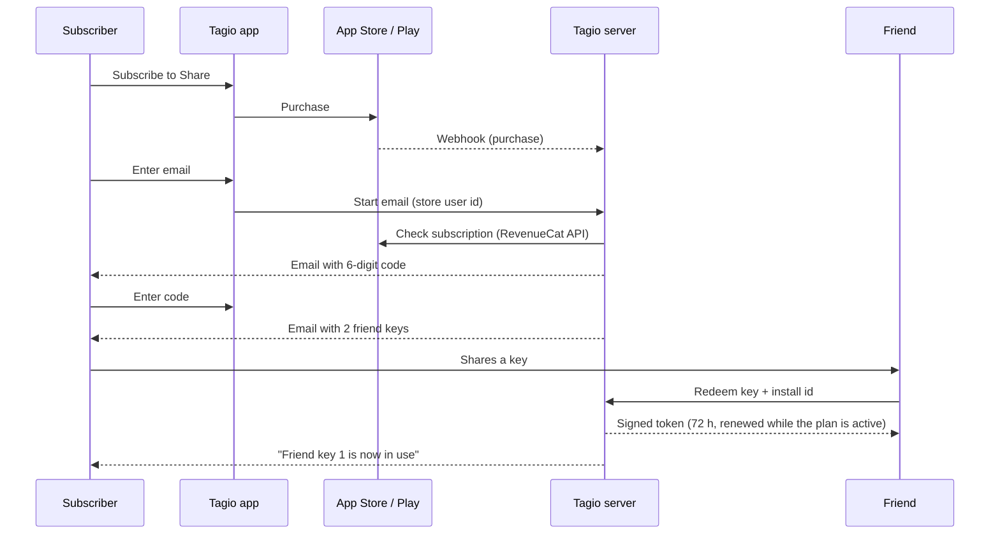

## Repository layout

```
tagio/
├── docs/                       README images (hero and screens)
├── app/                        Expo app (iOS + Android)
│   ├── app/                    Screens (Expo Router)
│   │   ├── index.tsx           Gate: camera if you have access, else Welcome
│   │   ├── welcome.tsx         First launch, pick your currency
│   │   ├── plans.tsx           Solo / Share, restore, friend key
│   │   ├── email.tsx, code.tsx Email confirmation
│   │   ├── keys.tsx            Your 2 friend keys
│   │   ├── scan.tsx            Camera, scan guide, conversion bar
│   │   ├── settings.tsx        Currencies, rounding, plan, friend slots
│   │   ├── currency.tsx        Full currency picker
│   │   └── redeem.tsx          Friend enters a key
│   ├── src/core/               Pure logic, fully unit-tested
│   │   ├── price.ts            Price reader
│   │   ├── detect.ts           Currency detection
│   │   ├── locker.ts           Keeps the reading steady
│   │   ├── money.ts            Conversion and formatting
│   │   ├── currencies.ts       153 currencies, flags, search, local currency by region
│   │   ├── keys.ts             Friend key input formatting
│   │   └── fallbackRates.ts    Bundled rates snapshot
│   ├── src/scan/               OCR hook, scan guide, conversion bar
│   ├── src/state/              Settings and access (store, owner, friend)
│   ├── src/ui/                 Glass, buttons, currency list and sheet
│   ├── src/lib/                API client, rates cache, storage
│   └── src/theme.ts            Colours, radii, type, motion
└── server/                     Cloudflare Worker
    ├── src/app.ts              Routes, webhook, cron jobs
    ├── src/crypto.ts           Keys, tokens, hashing, encryption (Web Crypto)
    ├── src/db.ts               D1 queries and rate limiting
    ├── src/email.ts            Email templates (Resend)
    ├── src/revenuecat.ts       Subscription check and webhook types
    ├── migrations/             D1 schema
    └── test/                   API tests on a local SQLite stand-in
```

## Tech stack

| Part | Choice |
|---|---|
| App | Expo SDK 58, React Native 0.88, TypeScript, Expo Router |
| Camera + OCR | `react-native-vision-camera` 5, `react-native-vision-camera-ocr-plus` (Google ML Kit, Latin script) |
| Motion | `react-native-reanimated` 4 |
| Glass | `expo-blur` (iOS); translucent tint on Android |
| Billing | RevenueCat (`react-native-purchases`) over StoreKit 2 and Google Play Billing |
| Storage | AsyncStorage for settings and rates; Keychain / Keystore (`expo-secure-store`) for tokens |
| Server | Cloudflare Workers, Hono, D1 (SQLite), KV, Cron Triggers |
| Email | Resend |
| Rates | Exchange Rate API (open.er-api.com), cached hourly in KV |
| Tests | Vitest |

## Getting started

### Requirements

- Node 22 or later
- The current Xcode (iOS) and/or Android Studio with SDK 36 (Android)
- A **real phone**: ML Kit has no Apple Silicon simulator build, and simulators have no camera
- Accounts: Apple Developer, Google Play Console, [RevenueCat](https://www.revenuecat.com), [Cloudflare](https://dash.cloudflare.com), [Resend](https://resend.com)

### 1. Set up the store products in RevenueCat

1. Connect your App Store and Google Play apps.
2. Create two monthly subscription products, one for **Solo** and one for **Share**.
3. Create two entitlements:
   - `tagio`: attach **both** products
   - `share`: attach the **Share** product only
4. In the **current offering**, add packages with the identifiers `solo_monthly` and `share_monthly`.

### 2. Deploy the server

```bash
cd server
npm install

npx wrangler d1 create tagio            # copy database_id into wrangler.toml
npx wrangler kv namespace create KV     # copy id into wrangler.toml

npx wrangler secret put TOKEN_SECRET            # long random string
npx wrangler secret put KEY_ENC_SECRET          # another long random string
npx wrangler secret put REVENUECAT_API_KEY      # RevenueCat secret API key (v1)
npx wrangler secret put REVENUECAT_WEBHOOK_AUTH # e.g. "Bearer <random string>"
npx wrangler secret put RESEND_API_KEY

npm run db:migrate
npm run deploy
```

Then:

- In RevenueCat, add a webhook to `https://<your-worker>/webhooks/revenuecat` with the same Authorization value as `REVENUECAT_WEBHOOK_AUTH`.
- Set `MAIL_FROM` and `SUPPORT_EMAIL` in `wrangler.toml`, on a domain verified in Resend.
- The rates file is filled by the hourly cron. To fill it straight away while developing, run `npx wrangler dev --test-scheduled`, then open `http://localhost:8787/__scheduled?cron=7+*+*+*+*`.

### 3. Run the app

```bash
cd app
cp .env.example .env      # fill in the API URL and RevenueCat public keys
npm install
npx expo prebuild
npx expo run:ios --device # or: npx expo run:android
```

For store builds, use [EAS Build](https://docs.expo.dev/build/introduction/): `npx eas build --platform all`.

## Configuration

### App (`app/.env`)

| Variable | What it is |
|---|---|
| `EXPO_PUBLIC_API_URL` | URL of the deployed Worker |
| `EXPO_PUBLIC_REVENUECAT_IOS_KEY` | RevenueCat public SDK key for iOS (`appl_…`) |
| `EXPO_PUBLIC_REVENUECAT_ANDROID_KEY` | RevenueCat public SDK key for Android (`goog_…`) |

Entitlement ids, package ids, the number of friend slots and the privacy and terms URLs are in `app/src/config.ts`.

### Server (`server/wrangler.toml` and secrets)

| Name | Kind | Default / purpose |
|---|---|---|
| `MAIL_FROM` | var | Sender, e.g. `Tagio <hello@tagio.app>` |
| `SUPPORT_EMAIL` | var | Shown in every email footer |
| `RATES_SOURCE_URL` | var | `https://open.er-api.com/v6/latest/USD` |
| `ENTITLEMENT_ANY` / `ENTITLEMENT_SHARE` | var | `tagio` / `share` |
| `FRIEND_SLOTS` | var | `2` |
| `MOVE_COOLDOWN_DAYS` | var | `30`: how often a key can move to a new phone |
| `TOKEN_TTL_HOURS` | var | `72`: how long a friend can stay offline |
| `TOKEN_SECRET` | secret | Signs app tokens |
| `KEY_ENC_SECRET` | secret | Encrypts friend keys so the owner can see them again |
| `REVENUECAT_API_KEY` | secret | Checks subscriptions server-side |
| `REVENUECAT_WEBHOOK_AUTH` | secret | Must match the webhook's Authorization header |
| `RESEND_API_KEY` | secret | Sends email |

Cron schedules: rates at minute 7 of every hour; renewal reminders daily at 06:23 UTC.

## Server API

All bodies are JSON. Errors return `{ "error": "<code>" }` with a matching HTTP status.

| Method | Path | Auth | Purpose |
|---|---|---|---|
| `GET` | `/health` | none | Liveness check |
| `GET` | `/v1/rates` | none | All rates per 1 USD, plus `updatedAt` (cached 15 min) |
| `POST` | `/v1/owner/email/start` | none | `{ appUserId, email }`: checks the subscription with RevenueCat, emails a 6-digit code |
| `POST` | `/v1/owner/email/verify` | none | `{ appUserId, code }`: returns `ownerToken` and access; creates and emails friend keys on Share |
| `GET` | `/v1/owner/access` | owner token | Plan, renewal date, email, friend slots |
| `POST` | `/v1/owner/slots/:no/replace` | owner token | New key for a slot; the old key stops working |
| `POST` | `/v1/keys/redeem` | none | `{ key, deviceId }`: returns a friend token |
| `POST` | `/v1/keys/refresh` | none | `{ token, deviceId }`: renews a friend token while the plan is active |
| `POST` | `/webhooks/revenuecat` | webhook secret | Store events: purchase, renewal, cancellation, billing issue, expiry |

Rate limits: 5 email codes per hour per user, 5 code attempts per code, and 10 redeems per hour per phone (20 per IP).

## Emails

| Email | Sent when |
|---|---|
| Your Tagio code | The subscriber adds or changes their email |
| Your Tagio friend keys | The email is confirmed on Share |
| New key for friend slot N | The subscriber replaces a key |
| Tagio receipt | Each purchase and renewal |
| Tagio renews on … / Tagio ends on … | 3 days before renewal, and when auto-renew is turned off |
| Payment didn't go through / Your plan has ended | Billing issue or expiry |
| Friend key N is now in use / moved / both in use | Friend key activity |

## Testing

```bash
cd app && npm test        # price reader, currency detection, conversion, locking, key input
cd server && npm test     # email codes, keys, redeem/move/replace, webhooks, cron jobs
npm run typecheck         # in either folder
```

Server tests run the real routes and SQL against Node's built-in SQLite, with RevenueCat, Resend and the rates feed mocked.

When a real tag is misread, add it as a test case in `app/src/core/__tests__/core.test.ts`, then fix the parser.

## Design system

| Token | Value |
|---|---|
| Primary | `#00D632` (always with black text) |
| Secondary | `#000000` |
| Neutral | `#F8F9FA` |
| Grey text / lines | `#5E6470` / `#E3E6EA` |
| Type | San Francisco (iOS), Roboto (Android) |
| Radii | 8 chips · 14 buttons and inputs · 20 cards · 28 sheets · full pills |
| Motion | `cubic-bezier(0.23, 1, 0.32, 1)` for UI, `cubic-bezier(0.32, 0.72, 0, 1)` for sheets; press 160 ms, lock 260 ms, sheet 440 ms |

Glass is used only over the camera. Every button and link scales to 97% while pressed.

## Before launch

- [ ] Test on **50 or more real tags** from your launch countries and add each miss as a test.
- [ ] Set prices in App Store Connect and Play Console. The app shows whatever price the store returns.
- [ ] Replace the placeholder icon in `app/assets/`.
- [ ] Publish a privacy policy and terms, and set their URLs in `app/src/config.ts`.
- [ ] Fill in the App Store privacy labels: email only, used for app functionality, not for tracking.
- [ ] In the App Review notes, explain that friend keys come only from the Share in-app purchase, and include a demo key.
- [ ] Verify your sending domain in Resend.

## Known limitations

- **Android glass** is a translucent tint, because Android can't blur a live camera view. iOS blurs for real.
- **Flags** are emoji. For flat flags that look identical on every phone, swap in an SVG flag set.
- **Rates** from the default free source update daily. For hourly rates, point `RATES_SOURCE_URL` at a paid feed with the same response shape, or adapt `refreshRates` in `server/src/app.ts`.
- **Scripts:** text recognition is set to Latin script. Tags in Arabic, Chinese, Devanagari, Japanese or Korean script need the extra ML Kit models (remove `disableNonLatinTextRecognition` in `app/app.json`).
- **Scan region** is a share of the camera frame, so on very tall or wide screens the on-screen guide and the area read may differ slightly.
